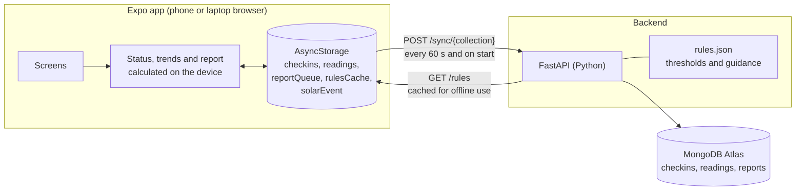
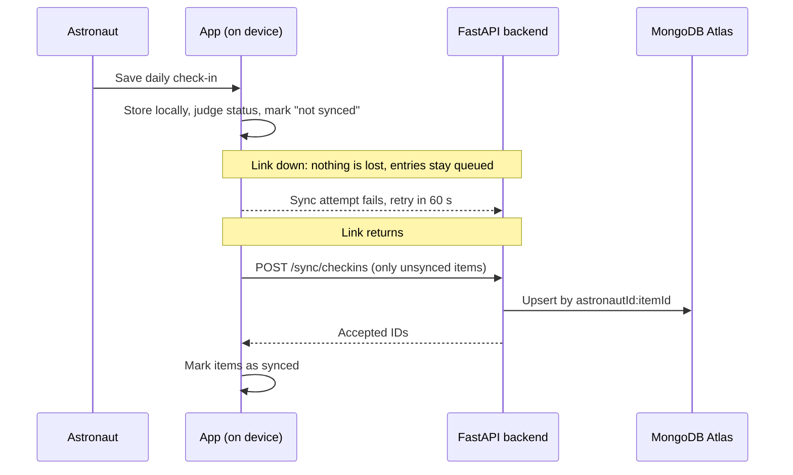
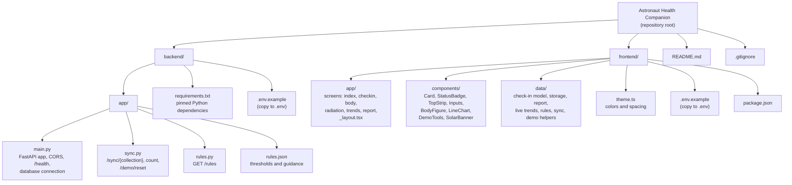

# Astronaut Health Companion (HARMONY)

**HARMONY: Health Assessment & Risk MONitoring sYstem**

A visual, offline-first tool that helps astronauts assess their own health on long space missions and gives simple guidance on what to do next. It runs on phones and on astronaut laptops (Expo / React Native Web), syncs to a small Python backend and MongoDB Atlas when the link is available, and is designed for low bandwidth and delayed communication.

> **Not a medical device.** This is a hackathon prototype for decision support only. Health limits are placeholders for review by medical experts, except the radiation career limit, which comes from NASA-STD-3001 (see [Sources](#sources)). Urgent symptoms must be discussed, handled, and treated by flight surgeons and Mission Control in real mission scenarios.

## Contents

- [Why](#why)
- [Features](#features)
- [Architecture](#architecture)
- [Tech stack](#tech-stack)
- [Repository layout](#repository-layout)
- [Getting started](#getting-started)
- [Troubleshooting](#troubleshooting)
- [Backend API](#backend-api)
- [Rules and guidance](#rules-and-guidance)
- [Demo walkthrough](#demo-walkthrough)
- [Known limitations](#known-limitations)
- [Sources](#sources)
- [AI Acknowledgement](#ai-acknowledgement)

## Why

NASA's Human Research Program groups the risks of human spaceflight into five hazards: space radiation, isolation and confinement, distance from Earth, gravity fields, and hostile/closed environments. On long missions, crews must be able to notice problems early without waiting for a round trip to Mission Control. This app turns a three-minute daily check-in into clear status colors, trends against the astronaut's own baseline, and plain-language actions.

## Features

- **Home:** overall status and score, the five NASA hazards, and a solar event banner.
- **Daily check-in (5 steps, about 3 minutes):** vitals (heart rate, blood pressure, temperature, optional blood sugar), mood and crew tension, symptoms, sleep, exercise, food and fluids, then review and save.
- **Body view:** tap a body area to see its function, what spaceflight changes, and related status.
- **Trends:** line charts (sleep, mood, heart rate, radiation dose) with a personal normal-range band and a flag line.
- **Radiation center:** dose readings against the NASA career limit (600 mSv effective dose).
- **Flight surgeon report:** active flags, indicator summary, symptoms, recommended actions, and an optional crew note. Queue it for the next link or save it as a text file.
- **What to do:** guidance for every flagged indicator, loaded from the backend `rules.json`.
- **Offline-first:** everything is saved on the device first. Entries queue and sync when the backend is reachable, and only changed items are sent, never the full history.
- **Demo tools (optional):** load demo history, simulate a solar particle event, and reset data.

## Architecture



- Status, trends and the report are calculated **on the device**, so they work with no connection.
- The backend owns the **rules** (thresholds and guidance text) and stores synced data for the flight surgeon side.
- Items are stored under the ID `astronautId:itemId`, so a retry never creates duplicates.

### What happens when the link drops



## Tech stack

| Layer | Technology |
| --- | --- |
| Frontend | Expo (React Native, expo-router), React Native Web, react-native-svg, AsyncStorage, TypeScript |
| Backend | Python 3.10+, FastAPI, uvicorn, pymongo, python-dotenv (mongomock as an in-memory fallback) |
| Database | MongoDB Atlas (use MongoDB Compass to inspect data) |

## Repository layout



> If your Expo template placed `app` inside `src/`, then `components`, `data` and `theme.ts` live in `frontend/src/` next to it.

## Getting started

You will run two programs side by side, each in its own terminal window: the **backend** (port 8000) and the **frontend** (port 8081).

### Requirements

| Tool | Version | Check with |
| --- | --- | --- |
| Git | any recent | `git --version` |
| Node.js and npm | LTS | `node --version` and `npm --version` |
| Python | 3.10 or newer | `python --version` (on Windows you may need `py --version`) |
| MongoDB Atlas | free tier is enough | a cluster with a database user and your IP in **Network Access** |

Without Atlas, the backend falls back to an in-memory database that is cleared on every restart, so you can still try the app.

### Step 1. Get the code

```bash
git clone <repository-url>
cd <repository-folder>
```

### Step 2. Backend (terminal 1)

All backend dependencies are listed with exact versions in `backend/requirements.txt`, so one command installs everything you need. The main packages are:

| Package | Used for |
| --- | --- |
| `fastapi` | The web API (with Starlette and Pydantic) |
| `uvicorn` | The server that runs FastAPI |
| `pymongo` | Connecting to MongoDB Atlas (with `dnspython` for `mongodb+srv://` addresses) |
| `python-dotenv` | Reading settings from `backend/.env` |
| `mongomock` | In-memory database used when no Atlas address is set |

The rest of the file lists their own dependencies, pinned so everyone gets the same versions.

**Windows (PowerShell):**

```powershell
cd backend
python -m venv .venv
.venv\Scripts\Activate.ps1
pip install -r requirements.txt
copy .env.example .env
```

**macOS / Linux:**

```bash
cd backend
python3 -m venv .venv
source .venv/bin/activate
pip install -r requirements.txt
cp .env.example .env
```

After activating, your prompt starts with `(.venv)`. Always install and run inside that environment.

**Fill in `backend/.env`** (open it in any text editor):

| Variable | What to put |
| --- | --- |
| `MONGODB_URI` | Your Atlas connection string, for example `mongodb+srv://cluster0.xxxxx.mongodb.net/`. Leave empty to use the in-memory fallback. |
| `MONGODB_USERNAME` and `MONGODB_PASSWORD` | Your database user, if the connection string does not already contain them. If you put them inside the string, leave these two empty. Special characters in a password must be URL-encoded when placed inside the string. |
| `MONGODB_DB` | Database name. Default: `astro_health`. |
| `DEMO_MODE` | `1` enables `DELETE /demo/reset` for rehearsals. Keep `0` otherwise. |

**Start the backend:**

```bash
uvicorn app.main:app --reload --host 0.0.0.0 --port 8000
```

**Check it works:** open <http://localhost:8000/health>. You should see `"status":"ok"` and the database mode. The interactive API page is at <http://localhost:8000/docs>. Leave this terminal running.

### Step 3. Frontend (terminal 2)

Open a **new** terminal window in the repository folder.

**Windows (PowerShell):**

```powershell
cd frontend
npm install
copy .env.example .env
```

**macOS / Linux:**

```bash
cd frontend
npm install
cp .env.example .env
```

`npm install` reads `package.json`, so it installs every frontend dependency (Expo, React Native Web, react-native-svg, AsyncStorage and the rest). Nothing else needs installing.

**Fill in `frontend/.env`:**

| Variable | What to put |
| --- | --- |
| `EXPO_PUBLIC_API_URL` | The backend address, for example `http://localhost:8000` |
| `EXPO_PUBLIC_DEMO` | `1` shows the demo tools on Home. Use `0` to hide them. |

**Start the app:**

```bash
npx expo start
```

- Press **`w`** to open the app in your browser (<http://localhost:8081>).
- To use a **phone**, install **Expo Go**, scan the QR code, and set `EXPO_PUBLIC_API_URL` to your computer's local network address (for example `http://192.168.1.20:8000`), because `localhost` on a phone means the phone itself. The phone and the computer must be on the same Wi-Fi network.
- Restart Expo (`Ctrl+C`, then `npx expo start --clear`) after changing `frontend/.env`.

### Step 4. Check that everything is connected

1. In the app, complete and save a daily check-in.
2. Wait up to a minute (or reload the page). The app syncs on start and every 60 seconds.
3. Open <http://localhost:8000/sync/checkins/count>. The `count` should go up.
4. With Atlas, you can also see the documents in MongoDB Compass, in the `checkins` collection of the `astro_health` database.

### Running it again later

Each time you come back, you only need to activate the backend environment and start both programs:

```powershell
# terminal 1
cd backend
.venv\Scripts\Activate.ps1
uvicorn app.main:app --reload --host 0.0.0.0 --port 8000

# terminal 2
cd frontend
npx expo start
```

(macOS / Linux: use `source .venv/bin/activate` instead of the `Activate.ps1` line.)

## Troubleshooting

| Problem | Fix |
| --- | --- |
| `Activate.ps1 cannot be loaded because running scripts is disabled` | In that PowerShell window run `Set-ExecutionPolicy -Scope Process Bypass`, then activate again. |
| `python` is not recognized (Windows) | Use `py` instead, for example `py -m venv .venv`. |
| `ModuleNotFoundError` when starting the backend | The environment is not active or the packages were not installed. Activate `.venv`, then run `pip install -r requirements.txt` again from the `backend` folder. |
| `Could not open requirements file` | You are not in the `backend` folder. Run `cd backend` first. |
| Quick check that all backend packages are installed | `python -c "import fastapi, uvicorn, pymongo, dotenv, mongomock; print('ok')"` should print `ok`. |
| A pinned package fails to install | Check `python --version` (3.10 or newer is required). On an older Python, create a new `.venv` with a newer one. |
| `/health` shows an in-memory database or an Atlas error | Check `MONGODB_URI`, the username and password, and that your IP is in Atlas **Network Access**. |
| The app cannot reach the backend | Make sure the backend is running, `EXPO_PUBLIC_API_URL` is correct, and Expo was restarted after editing `.env`. |
| Browser shows a CORS error when the app is opened at an address other than `http://localhost:8081` | Add that address to the allowed origins in `backend/app/main.py`. |
| Phone cannot connect | Same Wi-Fi, use the computer's local address (not `localhost`), and allow port 8000 through the firewall. |
| Port 8000 or 8081 already in use | Stop the other program, or choose another port and update `EXPO_PUBLIC_API_URL`. |
| `Hydration failed` warning in the browser | Make sure `app.json` has `"web": { "bundler": "metro", "output": "single" }`, then run `npx expo start --clear`. |

## Backend API

| Method and path | Purpose |
| --- | --- |
| `GET /health` | Returns service and database status |
| `POST /sync/{collection}` | Upserts a batch of items (`checkins`, `readings`, `reports`) and returns the accepted IDs |
| `GET /sync/{collection}/count` | Returns the number of stored documents (handy for testing) |
| `GET /rules` | Returns the current thresholds and guidance text |
| `DELETE /demo/reset` | Clears the three collections; only available when `DEMO_MODE=1` |

## Rules and guidance

All limits and advice sentences live in `backend/app/rules.json`. The app downloads them at start, caches them, and falls back to built-in defaults when offline. Edit the file, reload the app, and flags and actions change with no code changes. The report shows which rules were used (`built-in`, `cached` or `server`, plus the version).

## Demo walkthrough

1. Save one reading in the Radiation tab (the demo loader copies its shape).
2. On Home, press **Load demo history** to create 30 days of data with a late decline in sleep and mood.
3. Press **Simulate solar event** to show the alert banner and a dose jump.
4. Open **Trends** and **Report** to show flags, recommended actions and the text export.
5. Press **Reset demo data** twice to clear the device and the database.

## Known limitations

- Health thresholds (except the radiation career limit) and guidance are placeholders and not clinically validated.
- The radiation limit is the NASA career limit of 600 mSv; the Watch and Action levels (50% and 80%) are this app's own choice. Organ-specific and short-term limits are not included.
- Mission name, mission day and the hazard overview on Home are sample data.
- No login: everything is stored under one demo astronaut ID.
- Several check-ins in one day count as separate entries in baselines and streaks.

## Sources

- NASA Human Research Program: hazards, risks and ongoing research (nasa.gov/hrp).
- Canadian Space Agency: radiation monitoring on the ISS and why experiments are done in space.
- NASA Office of the Chief Health and Medical Officer, radiation protection technical brief (NASA-STD-3001): 600 mSv career effective dose limit, 250 mSv per solar particle event.

## AI Acknowledgement

Claude was used as an AI-assisted development tool during the creation of Astronaut Health Companion. Its assistance covered portions of both the frontend and backend implementation, as well as technical documentation.

Specifically, AI assistance was used for:

- **Frontend development:** generating, refining, and debugging portions of the TypeScript and React Native code, including UI components, screen layouts, navigation, data handling, local storage, visualizations, and synchronization logic.
- **Health assessment and guidance configuration:** assisting with the structure, organization, wording, and formatting of the backend `rules.json` file, including indicator descriptions, threshold configurations, status explanations, and recommended actions.
- **Backend development:** assisting with portions of the Python and FastAPI implementation, including API endpoint structure, data synchronization, database interactions, and configuration.
- **Documentation:** helping draft and refine the README, setup instructions, architecture descriptions, and technical explanations.
- **Debugging and development support:** explaining errors, suggesting fixes, reviewing code changes, and helping improve consistency across the application.

AI-generated suggestions and code were not treated as automatically correct or production-ready. The development team reviewed and adapted AI-assisted outputs, integrated them into the existing project, and performed testing to verify application functionality and compatibility.

The development team retains responsibility for the final implementation, design decisions, code integration, and project deliverables. In particular, the health thresholds and guidance included in this prototype are not clinically validated medical recommendations. AI assistance does not constitute medical or scientific validation of the application's health assessment logic.
